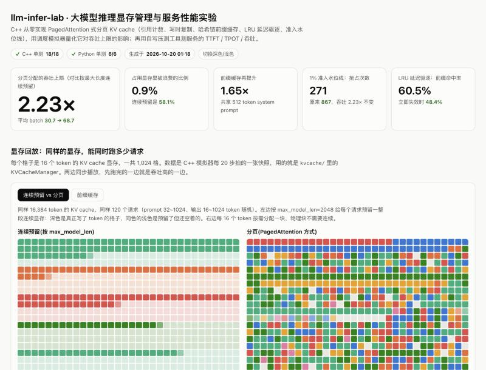

# llm-infer-lab：大模型推理显存管理与服务性能实验

用两部分代码，把大模型推理服务里最核心的两件事讲清楚、测清楚：

1. **`kvcache/`（C++17）**：从零实现 PagedAttention 的 KV cache 分页管理器，包括块分配、引用计数、写时复制（Copy-on-Write）、基于哈希链的前缀缓存、LRU 延迟驱逐和准入水位线；配一个调度模拟器，量化"连续预留"和"分页分配"在同样显存下的吞吐差距。
2. **`bench/`（Python，零依赖）**：OpenAI 兼容接口的流式压测工具，统计 TTFT / TPOT / ITL / 吞吐的 P50/P95/P99，支持闭环固定并发和泊松到达；在 vLLM + Qwen2.5-7B 上对比 BF16、AWQ-INT4、GPTQ-INT8、FP8 KV cache 和前缀缓存。

所有结果汇总在一个离线可打开的可视化面板 **`dashboard/index.html`** 里：显存格子动画回放（连续预留 vs 分页、有无前缀缓存）、全部模拟实验图表、压测曲线。



```
llm-infer-lab/
├── kvcache/                       # C++ 分页 KV cache
│   ├── include/kv_cache_manager.h
│   ├── src/kv_cache_manager.cpp   # BlockAllocator + KVCacheManager（含 LRU 驱逐、水位线）
│   ├── src/simulate.cpp           # 5 组调度模拟实验 + JSON / 动画数据导出
│   └── tests/test_kv_cache.cpp    # 18 个单元测试（无第三方依赖）
├── bench/
│   ├── bench.py                   # 流式压测客户端（闭环并发 / 泊松到达）
│   ├── sweep.sh                   # 并发扫描 1→128
│   ├── plot.py                    # 出图 + Markdown 汇总表（需要 matplotlib）
│   ├── report.py                  # 从压测结果和 vLLM 日志提取关键数字、生成 REPORT 表格
│   ├── mock_server.py             # 模拟推理服务（可模拟前缀缓存），没有 GPU 也能调试
│   └── test_bench.py              # 6 个单元测试
├── dashboard/
│   ├── template.html              # 面板模板（纯 HTML/SVG/Canvas，无外部依赖）
│   ├── build.py                   # 把 results/ 的数据打包进 index.html
│   └── index.html                 # 生成好的面板，双击打开
├── scripts/
│   ├── run_local.sh               # 一键：编译 → 单测 → 模拟器 → mock 压测 → 生成面板
│   └── mock_bench.sh              # 只跑 mock 压测
├── serve/
│   ├── download_models.sh         # 从 ModelScope 下载模型
│   ├── launch_vllm.sh             # 按实验配置启动 vLLM
│   └── run_all.sh                 # GPU 上一键跑完全部对比实验
├── docs/
│   ├── REPORT.md                  # 实验报告
│   └── INTERVIEW.md               # 面试问答
└── results/                       # sim.json / trace.json / 压测 JSONL / 图
```

## 快速开始

### 0. 一键跑完本地部分，打开面板（任何电脑，不需要 GPU）

```bash
bash scripts/run_local.sh            # 约 6 分钟，mock 压测占大头；SKIP_MOCK=1 只要十几秒
open dashboard/index.html            # Linux 用 xdg-open，Windows 直接双击
```

没装 CMake 也能跑，脚本会直接调用 `c++` 编译。

### 1. C++ 部分

```bash
cd kvcache
cmake -S . -B build && cmake --build build -j
./build/kv_tests                     # 18 个单元测试
./build/kv_sim                       # 5 组模拟实验，参数见 ./build/kv_sim --help
./build/kv_sim --json ../results/sim.json
```

### 2. 压测工具（本地用模拟服务调试）

```bash
python3 bench/mock_server.py --port 8000 &
python3 bench/bench.py --model mock --concurrency 8 --num-prompts 64 --tag mock
python3 bench/bench.py --model mock --request-rate 4 --num-prompts 64 --tag mock-poisson   # 泊松到达
python3 -m unittest discover -s bench
```

### 3. 真实 GPU 实验（RTX 4090 24GB）

```bash
pip install vllm
bash serve/download_models.sh
tmux new -s bench
bash serve/run_all.sh     # 依次启动各配置并做并发扫描，最后自动跑 report.py 和 build.py
```

## 实验结果

### 模拟实验：显存管理方式对吞吐上限的影响

KV cache 容量 65536 token（Qwen2.5-7B BF16 每 token 约 56KB，相当于 3.5GB），1000 个请求，prompt 长度 32~1024、输出长度 16~1024 随机，`max_model_len=2048`，块大小 16，随机种子 42。下面的表都是 `./build/kv_sim` 的原始输出（完整版在 `results/sim.md`）。

| 策略 | 总步数 | 平均 batch | 相对吞吐 | 显存占用率 | 占用中被浪费的比例 | 抢占次数 | 外部碎片拒绝 | 重算 token |
|---|---|---|---|---|---|---|---|---|
| 连续预留（按 max_model_len） | 16505 | 30.7 | 1.00x | 96.1% | 58.1% | 0 | 0 | 0 |
| 连续预留（已知输出长度，理想上限） | 11156 | 45.5 | 1.48x | 82.6% | 28.0% | 0 | 10104 | 0 |
| 分页（PagedAttention 方式） | 7388 | 68.7 | **2.23x** | 90.7% | **0.9%** | 867 | 0 | 484010 |
| 分页 + 1% 准入水位线 | 7408 | 68.5 | 2.23x | 90.4% | 0.9% | **271** | 0 | 152329 |

所有请求共享 512 token system prompt 时：

| 策略 | 总步数 | 平均 batch | 相对吞吐 | 前缀命中块 |
|---|---|---|---|---|
| 分页 | 5206 | 50.3 | 1.00x | 0 |
| 分页 + 前缀缓存 | 3152 | 83.1 | **1.65x** | 46976 |

结论：

- 连续预留按最大长度占坑，显存看着满了，其实 58% 是空的。就算提前知道输出长度，也会因为外部碎片（总空间够、但找不到连续一段）拒绝请求。
- 分页分配的浪费只剩最后一个块没写满的部分（<1%），同样显存能同时跑 2.2 倍的请求。代价是显存吃紧时需要抢占：被抢占的请求要重算 48 万个 token，模拟器没把它折算成时间，所以 2.23 倍偏乐观。
- 有公共前缀时，前缀缓存让多个请求共享同一份 KV，并发再提升 65%。

### 在基础实现上的改进

**准入水位线**：新请求分配完后，可用块不能低于总数的一定比例，给正在 decode 的序列留余量（vLLM 的 `watermark_blocks` 同一个思路）。分页 + 前缀缓存、负载同上：

| 水位线 | 平均 batch | 相对吞吐 | 抢占次数 | 重算 token | 重算占全部 prefill |
|---|---|---|---|---|---|
| 0 | 83.1 | 1.00x | 469 | 252229 | 32.3% |
| 0.5% | 83.0 | 1.00x | 147 | 78099 | 12.8% |
| **1%** | 82.6 | 0.99x | **48** | 23783 | 4.3% |
| 2% | 81.9 | 0.99x | 9 | 4123 | 0.8% |
| 5% | 79.9 | 0.96x | 0 | 0 | 0.0% |
| 10% | 75.9 | 0.91x | 0 | 0 | 0.0% |

1% 水位线让抢占减少 90%、重算 token 减少 91%，吞吐只降 0.6%；水位线再高就开始明显牺牲并发。

**LRU 延迟驱逐**：引用计数归零的缓存块不立即失效，放进 LRU 队列，仍然可以被新请求命中；只有没有真正空闲的块时才驱逐最久没用的。用一个更贴近线上的负载测：64 个应用各有 1024 token 的 system prompt，请求按 Zipf 分布落到不同应用上，`max_num_seqs=32`：

| 策略 | 前缀命中率 | 需要 prefill 的 token | 相对无缓存 | 驱逐块数 |
|---|---|---|---|---|
| 无前缀缓存 | 0.0% | 1290801 | 1.00x | 0 |
| 前缀缓存（引用归零立即失效） | 48.4% | 666161 | 0.52x | 0 |
| 前缀缓存 + LRU 延迟驱逐 | **60.5%** | 509857 | **0.39x** | 43761 |

冷门应用的请求零星到来，没有 LRU 时它的前缀在上一个请求结束时就丢了；有了 LRU，需要真正计算 prefill 的 token 又少了 23%。单元测试 `lru_keeps_freed_blocks_hittable` 验证了"请求 A 结束后，内容相同的请求 B 依然能命中缓存"。

**块大小实验**（分页，负载同实验一）：

| 块大小 | 1 | 4 | 16 | 64 | 256 |
|---|---|---|---|---|---|
| 占用中被浪费的比例 | 0.0% | 0.2% | 0.9% | 3.5% | 12.9% |
| 相对吞吐（对比连续预留） | 2.25x | 2.25x | 2.23x | 2.17x | 1.99x |
| 平均每个序列的块表长度 | 857.5 | 214.8 | 54.1 | 13.9 | 3.8 |

块越小浪费越少，但到 16 以下吞吐几乎不再涨，块表却线性变长；真实系统里块太小还会让 attention kernel 每次只读一小段显存，访存效率差。块太大则浪费明显上升，前缀缓存的粒度也变粗。16 是两头都不吃亏的折中。

**重算开销**：模拟器统计"被抢占的请求重新准入时需要重新 prefill 的 token 数"（上面表里的"重算 token"），让分页方案的代价可以量化。配套补了 `slot_utilization_after_fork_and_cow` 等测试，单元测试从 11 个增加到 18 个。

### 压测工具自检（mock 服务）

`bash scripts/mock_bench.sh` 在 mock 服务上跑并发 1→128 的扫描，用来验证压测和画图流程，**数字不代表 GPU 性能**。工具自身的口径用 Little 定律检查：闭环压测时"请求吞吐 × 平均 E2E 延迟"和设定并发的偏差在 1% 以内（见面板里的"Little 定律验算"）。

### GPU 实验：vLLM + Qwen2.5-7B-Instruct，RTX 4090

> 待补充：跑完 `serve/run_all.sh` 后，`bench/report.py` 会把关键数字写到 `results/headline.json` 和 `results/report_tables.md`（含 vLLM 日志里的 KV cache 容量），面板会自动出现量化对比和前缀缓存曲线。把表格和结论整理进 [docs/REPORT.md](docs/REPORT.md)，再把图贴在这里。

## 设计要点

- **失败不改状态**：`add_sequence` 先只读地算出需要多少块、能命中多少前缀块，不够就直接返回 false，保证调度器可以放心地"试一下"。
- **哈希链**：每个满块的哈希 = hash(前一块的哈希, 本块 token)。两个请求只有从开头起完全相同，才会命中同一个块；只有写满的块才登记，因为没写满的块之后还会被改。
- **写时复制**：`fork` 只增加引用计数；序列往引用计数大于 1 的最后一个块里写时，才分配新块并记录一次 `CopyOp`，交给执行层做显存拷贝。
- **LRU 延迟驱逐**：`BlockAllocator` 多了 `decref_retain` / `revive` 两个接口，归零的缓存块不回空闲栈而是进 LRU 队尾；分配时先用真正空闲的块，没有了才驱逐队头。命中 LRU 里的块时，它不能再算作可用空间（`lru_hits_are_not_counted_as_free_space` 测试）。序列逆序释放，尾部块先进 LRU、先被驱逐，前缀块留得更久。
- **准入水位线**：只在准入新请求时检查，不影响正在 decode 的序列追加 token；系统里没有序列时不检查，避免大请求永远进不来。
- **压测口径**：闭环固定并发（或泊松到达），`ignore_eos` 强制生成固定长度，正式统计前有预热；TTFT 以收到第一个非空 token 为准，TPOT = (E2E − TTFT) / (输出 token 数 − 1)；每轮结果附带 Little 定律验算。

## 局限

- 模拟器只建模显存，不建模计算；重算 token 只做了统计，没有折算成时间，所以分页方案的吞吐倍数偏乐观。
- 抢占只实现了 recompute，没有实现 swap 到 CPU 内存。
- 前缀哈希用的是 64 位 FNV 风格哈希，碰撞概率极低但不是零。
- 压测客户端用线程实现并发，几百并发以内没问题；更高并发建议改成 asyncio。

## 参考

- Kwon et al. *Efficient Memory Management for Large Language Model Serving with PagedAttention*. SOSP 2023.
- vLLM 文档与源码：Automatic Prefix Caching、`benchmarks/benchmark_serving.py`
