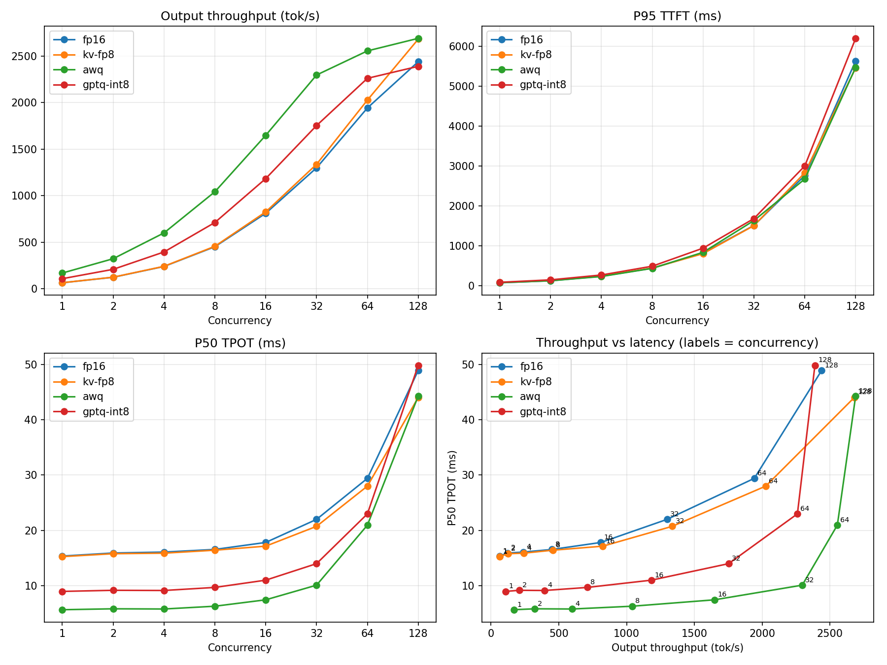
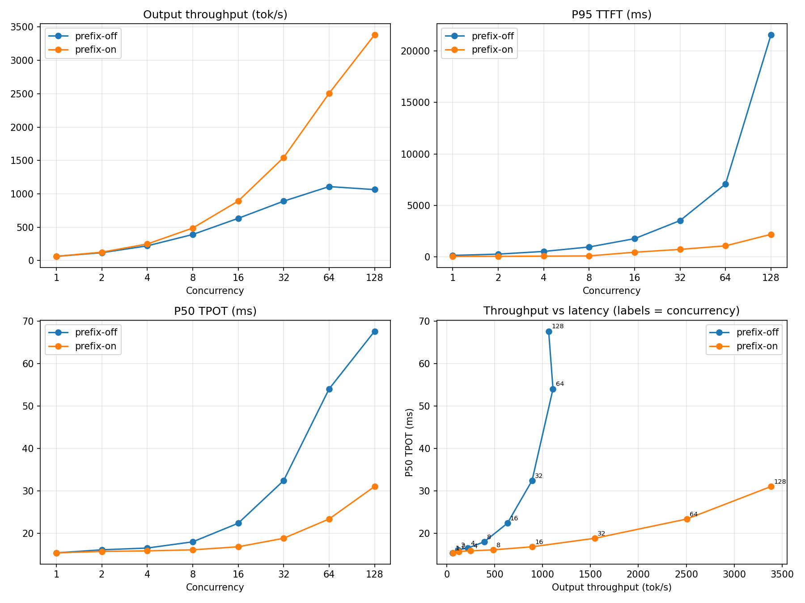

# 实验报告

> 第一部分是 C++ 调度模拟，数字来自 `kv_sim` 的原始输出；第二部分是在 RTX 4090 D 上用 vLLM 的实测，数字来自 `results/results.jsonl` 和 `logs/`。
> 每个结论都有图或表格支撑。复现：模拟部分 `bash scripts/run_local.sh`，GPU 部分 `bash serve/run_all.sh`，汇总 `python3 bench/report.py`。

## 第一部分：KV cache 调度模拟（已完成）

完整表格见 [README](../README.md#实验结果) 和 `results/sim.md`，可视化见 `dashboard/index.html`。

| 结论 | 支撑数据 |
|---|---|
| 分页分配把显存浪费从 58.1% 降到 0.9%，吞吐上限 2.23 倍 | 实验一：平均 batch 30.7 → 68.7 |
| 前缀缓存（共享 512 token system prompt）再提升 1.65 倍 | 实验二：平均 batch 50.3 → 83.1，命中 46976 块 |
| 1% 准入水位线让抢占减少 90%，吞吐只降 0.6% | 实验三：抢占 469 → 48，重算 token 252229 → 23783 |
| 块大小 16 是浪费和块表长度的折中 | 实验四：浪费 0.9%，块表 54 项；256 时浪费 12.9%、吞吐 2.23× → 1.99× |
| LRU 延迟驱逐让前缀命中率 48.4% → 60.5% | 实验五：需要 prefill 的 token 666161 → 509857（−23%） |

---

## 第二部分：GPU 实验（2026-10-26，AutoDL）

### 环境

| 项目 | 值 |
|---|---|
| GPU | NVIDIA GeForce RTX 4090 D 24GB（显存带宽 1008 GB/s，和 4090 相同；算力约少 10%） |
| 驱动 / CUDA | 595.71.05 / CUDA 13.0（torch 2.13.0+cu130） |
| vLLM | 0.32.0（V1 引擎，FlashAttention 2，默认开启 CUDA graph 显存预估） |
| 模型 | Qwen2.5-7B-Instruct：BF16、AWQ（4bit）、GPTQ-Int8，均从 ModelScope 下载 |
| 启动参数 | `max_model_len=4096`、`gpu_memory_utilization=0.9`、`max_num_seqs=256`；除 prefix-on 外都关闭前缀缓存 |
| 压测参数 | 输入 512 token、输出 256 token、`ignore_eos`，闭环并发 1→128，每轮请求数 = 并发 × 4（至少 32），2 个预热请求 |

完整环境记录在 `results/env.txt`，每个配置的 vLLM 启动日志在 `logs/`。

### 显存：手算 vs vLLM 日志

| 配置 | 权重显存（手算 → 实测） | 每 token KV | 可用 KV 显存 | 手算容量（可用显存 ÷ 每 token KV） | 日志 KV 容量 | 4096 长度最大并发 |
|---|---|---|---|---|---|---|
| BF16（压测时） | 14.2 → 14.29 GiB | 56 KB | 5.17 GiB | 96,806 | 96,880 | 23.65 |
| BF16（缓存命中后） | | 56 KB | 5.95 GiB | 111,411 | 111,328 | 27.18 |
| BF16 + FP8 KV（压测时） | 14.2 → 14.29 GiB | 28 KB | 4.83 GiB | 180,879 | 180,752 | 44.13 |
| BF16 + FP8 KV（缓存命中后） | | 28 KB | 5.60 GiB | 209,715 | 209,648 | 51.18 |
| AWQ-INT4 | 5.2 → 5.29 GiB | 56 KB | 14.09 GiB | 263,829 | 263,792 | 64.40 |
| GPTQ-INT8 | 8.2 → 8.29 GiB | 56 KB | 11.14 GiB | 208,592 | 208,496 | 50.90 |

每 token KV = 2 × 28 层 × 4 个 KV 头 × 128 维 × 2 字节 = 56 KB。手算容量和日志相差不到 0.1%，差的部分是块粒度（16 token 一块）和日志里 GiB 的四舍五入。

差异分析：
- **同一个 BF16 配置，两次启动的 KV 容量差了 15%**（96,880 vs 111,328）。看日志，第一次启动 torch.compile 从头编译（21 秒），profiling 时多占了约 0.8 GiB；之后命中 AOT 编译缓存（0.4 秒），可用 KV 显存从 5.17 GiB 变成 5.95 GiB。所以做容量对比时，要么都用首次启动，要么都用缓存命中后，不能混用。
- **FP8 的可用显存比 BF16 少 0.35 GiB**：日志里 FP8 配置的 CUDA graph 显存预估是 0.75 GiB，BF16 是 0.4 GiB。
- 赛前估算的 BF16 KV 容量是 10~12 万 token，实测 9.7~11.1 万；估算时把激活和 CUDA graph 的开销算成 1~2 GiB，实际是 21.59（24 GiB × 0.9）− 14.29（权重）− 可用 KV 显存 = 1.4~2.1 GiB。

### 实验一：量化对比

| 配置 | 并发 1 的 P50 TPOT | 理论下限 | 最高输出吞吐 | 达到最高吞吐的并发数 | 满足 P95 TPOT < 50ms 的最大吞吐 |
|---|---|---|---|---|---|
| BF16 | 15.4 ms | 14.0 ms | 2,439 tok/s | 128 | 2,439 |
| AWQ-INT4 | 5.7 ms | 4.4 ms | 2,689 | 128 | 2,689 |
| GPTQ-INT8 | 9.0 ms | 7.7 ms | 2,389 | 128 | 2,260 |
| BF16 + FP8 KV cache | 15.3 ms | 14.0 ms | 2,681 | 128 | 2,681 |

理论下限 = 每生成一个 token 要读的权重字节数 ÷ 1008 GB/s（BF16 14.1 GB、GPTQ-INT8 7.7 GB、AWQ-INT4 4.5 GB，embedding 表只读一行不算在内）。完整数据见 `results/quantization.md`。

预期：低并发时 AWQ-INT4 的 TPOT 明显更低（decode 访存瓶颈，权重小读得快）；高并发时优势变小（转为算力瓶颈，还有反量化开销）；INT4 省出来的显存给 KV cache，最大并发变大；FP8 KV cache 让 KV 容量接近翻倍。

结果：四条预期都成立。
- 单并发 TPOT：AWQ-INT4 5.7 ms，比 BF16 的 15.4 ms 快 2.7 倍；GPTQ-INT8 9.0 ms，快 1.7 倍。实测和理论下限之比就是带宽利用率：BF16 约 91%、GPTQ 约 86%、AWQ 约 77%，量化 kernel 达不到满带宽。
- 并发 128：AWQ-INT4 吞吐只比 BF16 高 10%，GPTQ-INT8 反而低 2%。
- KV 容量：AWQ-INT4 26.4 万 token，GPTQ-INT8 20.8 万，BF16 首次启动 9.7 万。
- FP8 KV cache：同条件下 KV 容量 111,328 → 209,648 token（1.88 倍）；单并发 TPOT 不变，并发 128 时 TPOT 48.9 → 44.0 ms、吞吐 +10%。

原因分析：
- 单并发时每步只算 1 个 token，计算量很小，耗时几乎全花在把权重从显存读出来上，所以 TPOT 和权重大小成正比。
- 并发变大后，同一份权重被 128 个请求共用，计算量上来了，瓶颈从访存变成算力；INT4/INT8 还要先反量化再算，GPTQ-INT8 在这里甚至不如 BF16。
- FP8 KV cache 不影响权重读取，所以单并发没有变化；大 batch 时每步要读的 KV 约 4.4 GiB（128 × 平均 640 token × 56 KB），和 14 GB 权重相比已经不可忽略，FP8 把它减半，TPOT 降了 10%。

### 实验二：前缀缓存

共享前缀 1024 token + 每个请求各自 256 token，输出 256 token。

| 并发 | prefix-off P50 TTFT | prefix-on P50 TTFT | 下降比例 | prefix-off 吞吐 | prefix-on 吞吐 | 吞吐提升 |
|---|---|---|---|---|---|---|
| 1 | 153 ms | 57 ms | 62.7% | 63 | 64 | +2.3% |
| 4 | 406 ms | 72 ms | 82.3% | 221 | 248 | +12.6% |
| 16 | 758 ms | 146 ms | 80.7% | 633 | 892 | +40.9% |
| 64 | 922 ms | 341 ms | 63.0% | 1,109 | 2,506 | +126.0% |
| 128 | 15,617 ms | 1,140 ms | 92.7% | 1,064 | 3,384 | +218.1% |

完整 8 档见 `results/prefix_cache.md`。

结论：
- TTFT：共享的 1024 token 只 prefill 一次，之后的请求直接复用 KV，所以 TTFT 在各档并发下都降了 63%~93%。
- 吞吐：提升从 +2% 涨到 +218%，越到高并发越明显，原因在显存而不是计算。不开前缀缓存时每个请求要独占 1536 token 的 KV，111,328 token 只够约 72 个请求同时跑，并发 128 时一半请求在排队，P50 TTFT 15.6 秒。开启后前缀只存一份，128 个请求只要约 6.7 万 token。这和 C++ 模拟器实验二的结论一致：显存吃紧时，前缀缓存省下的 KV 直接变成更大的 batch。
- 压测口径自检：48 轮里 47 轮 Little 定律偏差在 1% 以内。唯一的例外是 prefix-off 并发 128（−4.8%）：单个请求端到端约 30 秒，压测收尾时在飞请求少于 128 的那段时间占比变大。

## 总结

一句话结论：在 RTX 4090 D 上，decode 阶段单并发是访存瓶颈，AWQ-INT4 把 TPOT 从 15.4 ms 降到 5.7 ms，高并发时优势缩小到 10%；FP8 KV cache 让 KV 容量提升 1.88 倍；有 1024 token 共享前缀时，前缀缓存在并发 16 下让 P50 TTFT 降低 81%、吞吐提升 41%。
